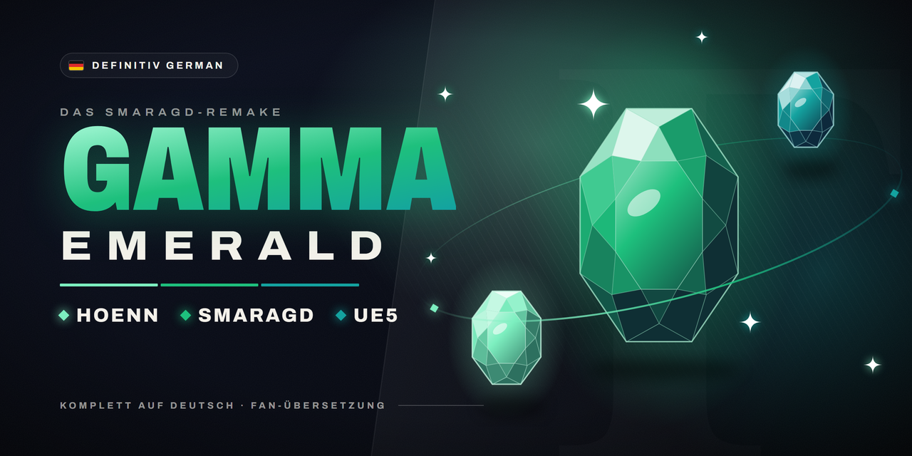

# Definitiv German Gamma Emerald

Komplett deutsches [Pokémon Gamma Emerald](https://undreamedpanic.itch.io/gamma-emerald-ea) – das Fan-Remake der
Smaragd-Edition von UndreamedPanic, so, als wäre es auf Deutsch erschienen.

*A full German translation of Pokémon Gamma Emerald (Windows). Ready to play – just unzip and start.*

## Was die Übersetzung macht

- **Alle Texte** – Dialoge, Kämpfe, Menüs und Ereignisse auf Deutsch
- **Alle Namen** – Pokémon, Attacken, Items, Trainer, Typen, Orte mit den bekannten deutschen Bezeichnungen
- **Sofort spielbar** – fertige Spielversion, einfach entpacken und starten

## Voraussetzungen

- **Windows** (64 Bit)
- Ca. **1,5 GB** für den Download und etwas mehr freien Speicher zum Entpacken

## Installation

1. Die `.zip` aus dem [neuesten Release](https://github.com/FadeyMods/Definitiv-German-Gamma-Emerald/releases/latest)
   herunterladen.
2. In einen beliebigen Ordner entpacken.
3. Im entpackten Ordner die **`PokemonEmerald.exe`** starten und spielen.

Was sich in einer Version geändert hat, steht im jeweiligen
[Release](https://github.com/FadeyMods/Definitiv-German-Gamma-Emerald/releases).

## Fehler gefunden?

Bitte als [Issue](https://github.com/FadeyMods/Definitiv-German-Gamma-Emerald/issues) melden – mit der Stelle im
Spiel, dem betroffenen Text und wenn möglich einem Screenshot. Nur Fehler der **deutschen Übersetzung**;
allgemeine Spielfehler betreffen die Originalversion von UndreamedPanic.

Inoffizielle, kostenlose Fan-Übersetzung ohne Verbindung zu Nintendo, Game Freak, Creatures Inc. oder The Pokémon
Company. Pokémon sowie alle zugehörigen Namen und Marken gehören ihren jeweiligen Rechteinhabern.

Weitere Projekte: [Definitiv German Gen 1](https://github.com/FadeyMods/Definitiv-German-Gen-1) · [Definitiv German Gen 2](https://github.com/FadeyMods/Definitiv-German-Gen-2) · [Definitiv German Gen 3](https://github.com/FadeyMods/Definitiv-German-Gen-3)
